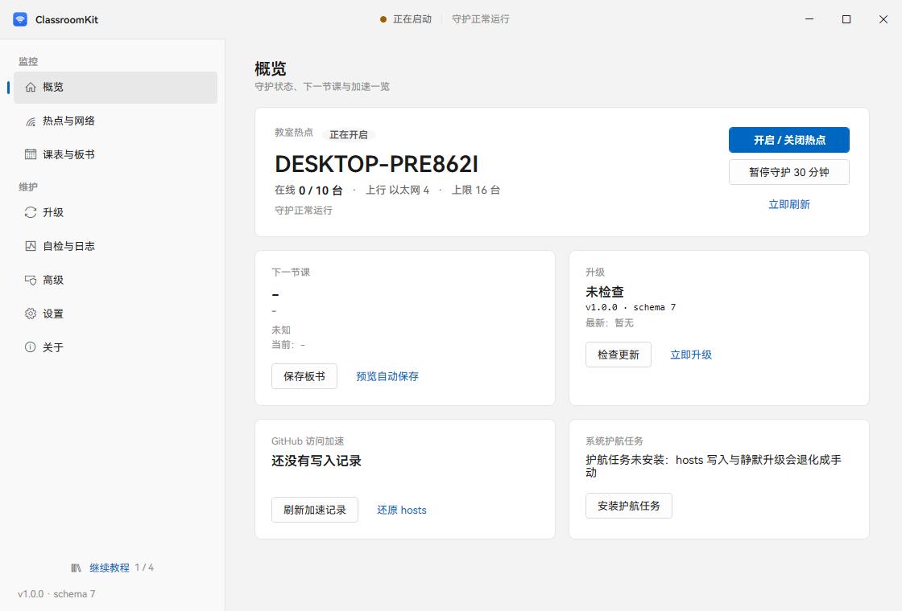
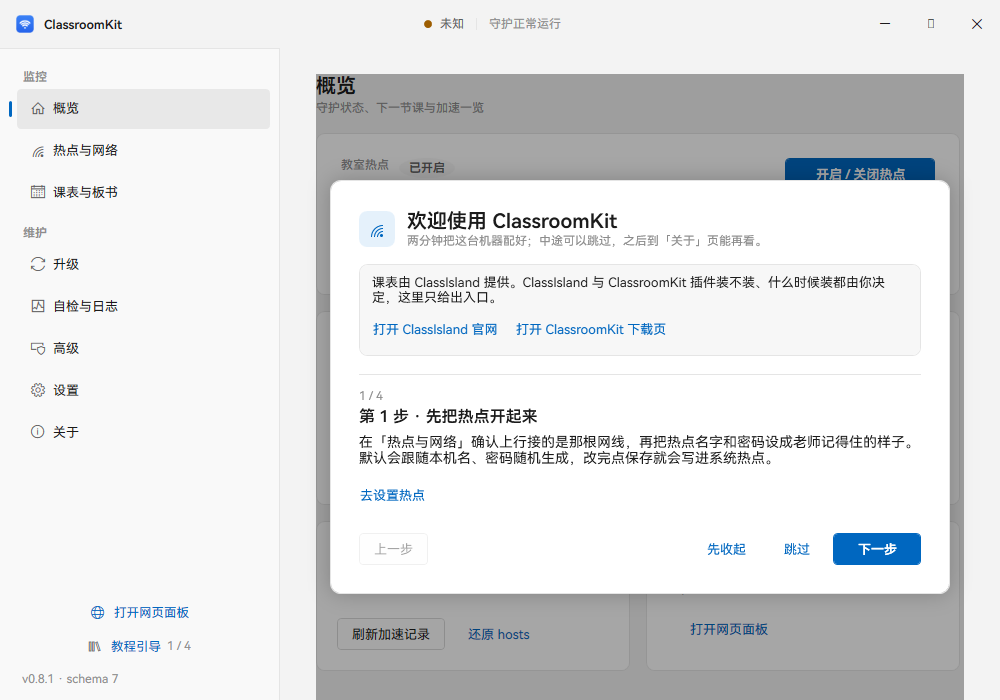
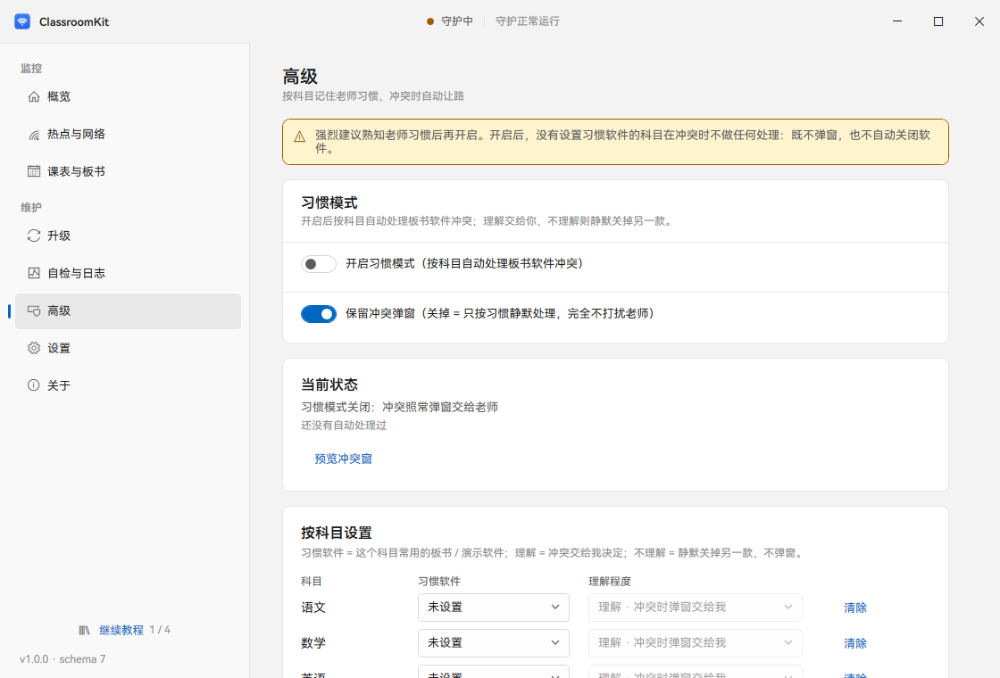
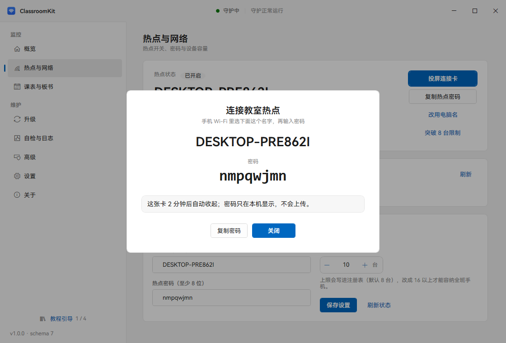
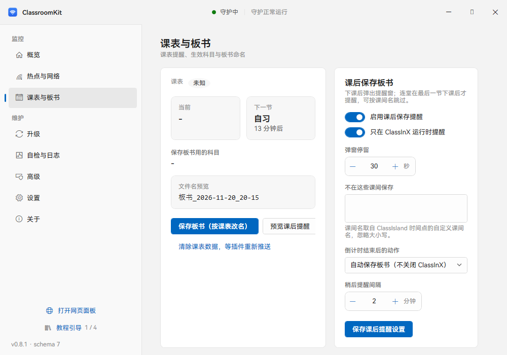

# ClassroomKit · 教室一体机助手

装在教室一体机上的小工具。它替老师记住四件每天都会碰到的事：**下课后把板书存好**、**按科目给板书起名**、**让学生手机连得上热点**，以及**在希沃白板和 ClassInX 打架时提醒一句**。GitHub 访问慢和静默升级也顺手处理了。

1.0 起，课后保存不再弹窗打断课堂：下课 5 分钟后安静地等 15 秒，没人碰鼠标键盘就自动保存；老师一动，它就退回去再等。

1.0.1 修好保存收尾：等 ClassInX 的保存窗口真正消失再结束进程，不让最后一个 `.edb/.png/.pdf` 冒被截断的风险。

1.0.2 修自动保存的点击：保存前重新定位「保存」按钮并强制切到前台，第一下被系统吞掉时补点一次；倒计时最后 2 秒先收起提醒，避免遮住按钮。

1.0.3 把「什么时候出现」理顺：开机自启、静默升级、UAC 兜底重启都只进托盘，不再把主界面弹到老师面前；「升级」页点一次「立即更新」就完成检查、下载与安装。

1.0.4 把板书拆成独立页：自动保存按科目进文件夹、文件名带第几节；下一节同科目时，打开 ClassInX 会问要不要接着上一节的板书；保存后还会清屏。另加「实验」页，内置维词自动领读。

1.1.0 修掉一批升级、保存、热点与诊断上的中高危问题：升级或首次安装完成后自动打开主界面；连堂课间不再保存，等这门课最后一段下课再存；清屏改成 Ctrl+A 后按 Delete（可改 Backspace），画面没变化不算成功；安装包只发 MSI 与 ClassIsland 插件，不再提供绿色版。

单文件 exe（约 80 MB，自包含，目标机不用装 .NET）；原生桌面主界面 + 托盘常驻；管理员账户下默认以管理员权限运行，标准账户也能启动。



| 首次启动的教程引导 | 高级 · 按科目记住老师习惯 |
| --- | --- |
|  |  |
| **投屏连接卡** | **课表页（1.0 版截图）** |
|  |  |

## 下载安装

预编译包在 [Releases](https://github.com/FoolishWiser/ClassroomKit/releases/latest)：

- `ClassroomKit-1.1.0-x64.msi`（约 74 MB，唯一安装包）
- `ClassroomKit-1.1.0.cipx`（ClassIsland 2.1 插件，装进 ClassIsland，不是安装包）

```text
双击 ClassroomKit-1.1.0-x64.msi
# 或静默安装：
msiexec /i ClassroomKit-1.1.0-x64.msi /qn
```

装完自动落地到 `C:\Program Files\ClassroomKit`、建配置目录、放宽设备上限到 16 台、注册登录自启与 SYSTEM 护航任务，并立刻拉起守护。首次安装会直接打开主界面，方便看教程；升级装完也会自动打开主界面，不用再去托盘里点；只有开机自启保持安静，只到托盘。开始菜单会多一项「ClassroomKit 助手」。默认按「最高可用权限」启动：管理员账户直接提权，标准账户仍以普通权限运行。

插件：ClassIsland → 设置 → 插件 → 从本地安装 → 选 `.cipx` → 重启 ClassIsland。**装不装插件不影响上网**，只影响课表联动与 1.0 的倒计时通知。

卸载、手动升级与「强力卸载」组件的细节见 [部署手册](docs/部署手册.md)。

## 能做什么

**课后自动保存板书（1.0）**。课间开始后第 5 分钟，ClassIsland 通知区出现 15 秒倒计时；这 15 秒里没人碰鼠标键盘，就自动保存。老师动一下鼠标或按一下键，倒计时立刻停下，10 秒后再试；再动，再等。一直拖到上课前 2 分 30 秒还没存成，就放弃这一次，不弹窗、不抢窗口。`lesson.skipBreakNames` 里的课间（如跑操）也跳过。连堂的中间课间不保存，等这门课最后一段下课再存一次，避免把同一份板书切成两半。老师一直碰鼠标也不至于拖到上课：连续操作最多顺延 60 秒，到点就保存。

**板书按科目归档、名字带第几节（1.0.4）**。`文档\ClassIn X Files\数学\数学_第3节_2026-11-14_10-05.png`。正在上课用当前科目，课间用上一节；模板 `boardSave.nameTemplate` 支持 `{科目}` `{日期}` `{时间}` `{节次}` `{周几}`，默认 `{科目}_{节次}_{日期}_{时间}`；只替换模板里写出的占位符，不会擅自追加节次。同名不覆盖、自动补 `_2`。保存后会校验文件真的写完（0 字节 / 半截 PDF 判失败），不会假装成功。

**下一节同科目续用（1.0.4）**。上一节存过板书、下一节又是同一门课并且已经上课时，打开 ClassInX 会弹一次置顶提示（60 秒自动关闭）：「数学老师您好，发现您在周五的第 3 节数学课中有板书保存，是否续用？」点「续用」直接打开最近那份 `.edb`，「稍后」10 分钟后再问，「这次不用」这次课不再提。开关在「板书」页。

**保存后清屏（1.1.0）**。关掉 ClassInX 本来就会清屏；保留 ClassInX 时，程序会把板书窗口切到前台，确认前台后按 Ctrl+A 全选，再按 Delete（可在「板书」页改成 Backspace）。前后各截一次 32×32 亮度指纹，画面没变化会换另一个键再试；仍然没变化就只记日志、提示「已发送但画面未变化」，不谎报清屏成功。

**学生热点**。开机就有，被关 / SSID 被改 / 网卡抽风都会自动恢复；上限从 Windows 默认 8 台放到 16 台。默认热点名 = 计算机名、密码每机随机，推车换教室时手机不会粘在旧热点上。多块网卡时自己挑真有外网的那块，谁都没外网就退回局域网兜底。网络异常时先复位无线网卡并重开热点；自检页也能手动「检查并修复」。

**连接卡与在线设备（1.0）**。热点页点「投屏连接卡」，全屏大字显示 SSID 和密码，点一下复制，两分钟自动收起，不用再眯着眼念小字。在线设备卡列出名称、IP、MAC 和已连接时长；同一台设备刷新后时长会继续涨，不再永远显示「刚刚」。

**板书中心（1.0.4 独立页）**。左侧「板书」页直接看保存目录、文件总数与总大小、磁盘剩余、最近文件与保存历史；按科目分文件夹后，一眼就能看出这节课存过什么。点「打开目录」就在资源管理器里定位，不用记路径。

**板书软件冲突**。每 2 秒看一眼窗口，希沃白板与 ClassInX 的悬浮窗叠在全屏内容上时弹一次置顶提示（都保留 / 保留其一 / 都不保留，40 分钟冷却）。可以在「高级」页按科目记住老师习惯：理解 = 冲突时弹窗交给老师，不理解 = 老师打开习惯软件时静默关掉另一款。

**实验页：维词自动领读（1.0.4）**。内置 weici-autoread：填首词、尾词，选发音与循环次数，先「试运行」看匹配对不对，再「开始」；日志实时滚动。只驱动已经登录的维词窗口，不读取也不保存账号密码。

**GitHub 加速与静默升级**。全天维护一小段 GitHub hosts（直连可用时不动），写坏了自己还原；升级下载完交给 SYSTEM 护航任务 `msiexec /qn` 安装，不弹 UAC，代价是最多排队 5 分钟。支持时间窗、无设备连接时才自动装。

**一键自检、诊断包与崩溃日志（1.0）**。12 项检查（版本、热点、上行、设备上限、自启、护航任务、hosts、板书目录、ClassInX、课表接入、网络自我修复、升级设置），红了会写下一步。自检页可一键导出脱敏诊断包（自检、环境、配置摘要、在线设备、最近日志），桌面出现 `ClassroomKit-诊断-*.zip`；未处理异常会落到 `%ProgramData%\ClassroomKit\logs\crash-*.txt`，不再静默消失。

## 界面与配置入口

左侧十页：**概览**、**热点**、**课表**、**板书**、**升级**、**自检与日志**、**高级**（按科目记习惯）、**实验**（维词自动领读）、**设置**、**关于**（版本 / 仓库 / Star / 下载 / 许可）。整体按 WinUI 3 的视觉语言重做：自绘标题栏、圆角卡片、开关式控件、浅色/深色跟随系统，界面内嵌 HarmonyOS Sans 字体（不装进系统）。

第一次用空白配置会弹四步教程（开热点 / 关联课表 / 冲突与习惯 / 自检）。中途点「先收起」或按 Esc，左下角入口会变成「继续教程」，下次启动仍从原步骤接着看；点「完成」后入口消失，不再打扰；「关于」页随时可以重新打开。

- 配置文件：`C:\ProgramData\ClassroomKit\config.json`，字段逐项说明见 [配置参考](docs/配置参考.md)
- 命令行与 HTTP API 见 [命令行与接口](docs/接口与命令行.md)；自动保存状态在 `GET /api/board-autosave`
- 网页面板已在 0.8.2 移除；`http://127.0.0.1:36037/` 只保留给 ClassIsland 插件的本地 `/api`，浏览器直接访问根路径会返回 404

## 文档与开发

- [部署手册](docs/部署手册.md) —— 装、验、还原卡、升级、卸载、排障
- [配置参考](docs/配置参考.md) —— config.json 每个字段
- [命令行与接口](docs/接口与命令行.md) —— CLI 与本地 HTTP API
- [ClassIsland 接入](docs/ClassIsland-接入.md) —— 插件安装与课表联动；1.6/1.7 的零代码配方
- [原理与限制](docs/原理与限制.md) —— 设备上限怎么破的、为什么不写服务、自动保存怎么计时、还剩下什么限制
- [WinUI 3 评估](docs/WinUI3-评估.md) —— 为什么继续用 WPF
- [版本与发布](docs/版本与发布.md) / [更新记录](docs/release-notes.md)

代码结构：`Core` 纯逻辑（Linux 可单测）、`Agent` WPF 桌面与 WinRT 热点、`ClassIsland` 插件。测试零依赖：

```text
dotnet run --project tests/ClassroomKit.Tests -c Release   # 224 项
```

整机验收清单在目标机跟着 [部署手册](docs/部署手册.md) 第 4 节逐条跑。

## 许可

[MIT](LICENSE)。界面内嵌 HarmonyOS Sans 字体，其许可见 [第三方声明](THIRD-PARTY-NOTICES.md)。
