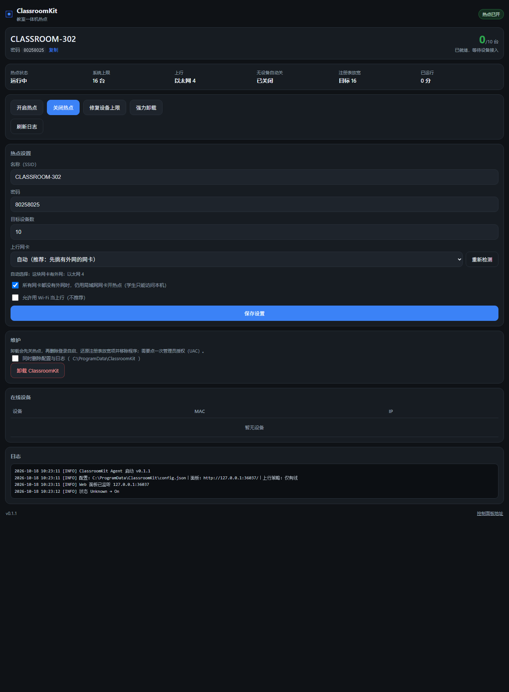
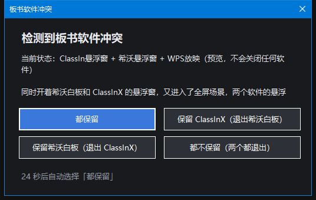

# ClassroomKit · 教室一体机助手

装在教室一体机上的小工具，管三件老师每天都会碰到的事：**上课前提醒保存板书**、**把板书存成看得懂的文件名**、**学生手机连得上的热点**。此外还顺手处理了 GitHub 访问慢（hosts 护航）和静默升级。

- 一个 **单文件 exe**（约 70 MB，自包含，目标机不需要装 .NET）
- 托盘常驻 + 本地网页面板（`http://127.0.0.1:36037/?t=令牌`）
- 上课前 **5 分钟**弹一次提醒窗（时间与提前量可改），不点也会替你保存
- 板书按 **上一节课的科目** 改名：`数学_2026-11-14_10-05.png`
- 热点由守护进程负责：开机就有、被关会自动恢复，学生上限从 8 台放到 16 台
- 全程静默升级：下载完交给 SYSTEM 护航任务装，不弹 UAC；hosts 只在直连 GitHub 不通时才动



> 上图是 0.3 的面板。0.4 把面板重排成「课表 → 课堂设备 → 热点设置 → 冲突 → hosts → 自检 → 升级 → 设备 → 日志 → 维护」，课表卡放在最上面。

## 为什么热点不是插件、课表却是插件

上课要用的东西分两类：**会跟课表软件一起崩的**，和**不能跟课表软件一起崩的**。

| 组件 | 为什么这样放 |
| --- | --- |
| 热点本体 | 必须是独立守护进程：登录 8 秒后自己起，ClassIsland 没开、老师没登录、课表软件正在升级，热点都照常工作。把热点做进插件的话，课表软件一崩学生就断网 |
| 课表与板书 | 必须靠 ClassIsland：只有它知道这节课是数学、下一节几点开始。所以做成 **ClassIsland 2.1 插件**（`.cipx`），把课表快照推给守护 |

插件只通过 `127.0.0.1:36037` 跟守护说话。**插件崩了不影响上网，守护崩了热点也会自己起来。**

还在用 ClassIsland 1.6 / 1.7、或不想装插件的：课前提醒与按科目改名需要课表，这版用不了；热点、板书保存、hosts、升级仍然可用（零代码「自动化」喊 `--ensure`，见 [ClassIsland 接入](docs/ClassIsland-接入.md)）。

## 下载

预编译安装包在 [Releases](https://github.com/FoolishWiser/ClassroomKit/releases)：

- `ClassroomKit-0.4.0-x64.msi`（约 63 MB，推荐）
- `ClassroomKit-0.4.0-win-x64.zip`（绿色版）
- `ClassroomKit-0.4.0.cipx`（ClassIsland 2.1 插件，不是安装包，装到 ClassIsland 里）

前两个都是自包含单文件，目标机不需要装 .NET。从 0.3.0 起只发正式版，装了就自动收到后续正式版的升级提示。

## 快速开始

### 方式一：MSI 安装包（推荐）

```text
双击 ClassroomKit-0.4.0-x64.msi
# 或者命令行静默安装：
msiexec /i ClassroomKit-0.4.0-x64.msi /qn
```

装完自动：落地到 `C:\Program Files\ClassroomKit` → 建 `C:\ProgramData\ClassroomKit` 并授权普通用户可写 → 放宽设备上限（`WifiMaxPeers=16`）→ 注册登录自启任务 → 注册 SYSTEM 护航任务 → 立刻拉起守护。开始菜单会多一项「ClassroomKit 控制面板」，点了直接带令牌打开面板（等价于 `--panel`）。

再装插件：打开 ClassIsland → 设置 → 插件 → 从本地安装 → 选 `ClassroomKit-0.4.0.cipx` → 重启 ClassIsland。设置页里会出现「ClassroomKit 助手」，里面能看到课表联动状态。

### 方式二：绿色目录（没有安装包时）

```powershell
# 1. 在一台装了 .NET 8 SDK 的 Windows 上打包（只需一次）
powershell -ExecutionPolicy Bypass -File scripts\build.ps1

# 2. 把 dist 整个目录拷到一体机，右键「以管理员身份运行 PowerShell」
cd D:\ClassroomKit
powershell -ExecutionPolicy Bypass -File install.ps1
# 默认热点名 = 这台电脑的计算机名，密码随机 8 位；要指定就加 -Ssid / -Passphrase

# 3. 面板里确认「热点已开」，手机连上试一下
```

绿色版不会注册 SYSTEM 护航任务（hosts 与静默升级要用它），需要时手动补一次：

```powershell
& "C:\Program Files\ClassroomKit\ClassroomKit.Agent.exe" --install-service
```

「强力卸载」按钮要拉起的 BCUninstaller 约 100 MB（自带 .NET 运行时），默认不塞进安装包。需要时在一体机上跑一次：

```powershell
powershell -ExecutionPolicy Bypass -File get-bcu.ps1
```

它会把便携版解到 `C:\Program Files\ClassroomKit\BCU\`（也可手动放；或在 `config.json` 里写 `bcu.path`）。不放的话热点功能完全不受影响，只是点按钮会提示没找到。

## 上课前提醒保存板书

课间只有十分钟，老师经常直接走人、下一节回来发现上一节板书还在 ClassInX 里没存。装好插件后：

1. ClassIsland 推课表给守护（每秒最多一次，课间/上课/放学都会更新）；
2. 离下一节上课还有 **5 分钟**（`lesson.remindMinutesBefore`，1–30 可调）时弹一次提醒窗；
3. 窗口默认 **30 秒**后自动执行「保存，但不关 ClassInX」（`lesson.timeoutAction=save`），老师什么都不用点；
4. 鼠标停在窗口上倒计时会暂停；键盘 <kbd>1</kbd> 保存、<kbd>2</kbd> 保存并关闭、<kbd>3</kbd> 稍后提醒（默认 2 分钟后再问）、<kbd>Esc</kbd> 稍后提醒。

细节：

- 同一节课只提醒一次（按「下一节开始时刻」去重）；稍后提醒只挡住那几分钟，过窗还没上课会再问；
- 默认只在 **ClassInX 正在运行**时提醒（`lesson.onlyWhenClassInBoard=true`），避免每节课都弹一个「没有板书可存」；
- 课表数据超过 2 小时没更新（`lesson.staleMinutes=120`）就不提醒 —— ClassIsland 被关了、或插件没在跑时不会瞎猜；
- 面板「课表」卡片可以改提前量、弹窗秒数、超时动作（保存 / 保存并关闭 / 一直等 / 忽略），也可以点「预览课前提醒」当场看效果。

## 板书存成「科目_日期_时间」

保存板书时如果课表可用，文件名会按上一节课命名：

```text
文档\ClassIn X Files\数学_2026-11-14_10-05.png
```

- 正在上课 → 用**当前**科目；课间/刚下课 → 用**上一节**科目；课表数据太旧 → 回默认的 `黑板_日期_时间`，宁可不好找也不张冠李戴；
- 模板可改（`boardSave.nameTemplate`，面板里也能改），占位符：`{科目}` `{日期}`（2026-11-14）`{时间}`（10-05）`{节次}`（第3节）`{周几}`；
- 不想按课表改名：面板里关掉「保存时按上一节课改名」，或命令行 `--save-board --no-name`；
- 同名文件已存在时自动补 `_2`、`_3`，不会覆盖；ClassInX 还占着文件时重试 3 次，仍失败就保留原名并在气泡里说明。

保存入口有四个，都走同一条流程（Ctrl+S → 保存至本地 → 三种格式全勾 → 保存 → 可选关闭）：

| 入口 | 说明 |
| --- | --- |
| 提醒窗（课前） | 默认自动保存、不关 ClassInX |
| 面板「现在保存板书」 | 按配置决定是否关闭 |
| 托盘 → 保存板书 | 子菜单：保存并关闭 / 保存保留 / 不按课表改名 / 预览课前提醒 |
| ClassIsland 插件 | 设置页按钮；自动化里还有「开启教室热点 / 关闭教室热点」两个行动 |
| 命令行 | `--save-board`（`--close` / `--no-name` / `--no-launch`） |

板书是空的、或 ClassInX 停在启动台时，只会提示「请先在板书上写点内容」，不会假装成功。换了 ClassInX 版本按钮位置变了：`--probe-classin` 重新探测，坐标写进 `%ProgramData%\ClassroomKit\ui-recipe.json`。

## 热点（学生上网）

热点是基础能力，不是主角，但该有的都在：

- 开机就来：登录自启任务延迟 8 秒，老师还在输密码热点就已经起来了；
- 守护式：被关、SSID 被改、网卡抽风、系统到点自动关热点，都会自动恢复；
- **8 台上限**：那是 Windows 移动热点自己的默认值。安装时写 `WifiMaxPeers=16` 并重启 `icssvc`，实测 `MaxClientCount` 从 8 变成 16，不需要第三方驱动；
- 默认热点名 = **这台电脑的名字**，密码每机随机 8 位（老配置原样保留）。推着车换教室时手机不会还粘在 `CLASSROOM-302` 上；面板会提示一次「改用电脑名」；
- 面板或 `--status` 能看到在线设备、每台设备的 MAC/IP。

## 多块网卡：自动挑「真有外网」的那块

一体机上常有好几块有线网卡（校内网 / 监控 / 预留），学校还经常整片断外网。程序不靠「Windows 默认连接」，而是自己枚举所有网卡再挑：

1. **有外网**（NCSI 判定能上网）的优先；同是有外网时，有线优先于无线，再看默认路由 metric（小者优先）和速率；
2. 谁都没外网 → **退回局域网兜底**（`uplink.fallbackToLan`）：只要有网关就用，学生连上能访问一体机上的课件，只是上不了外网；
3. 连网关都没配、只有 IP → 也允许兜底开热点，优先级低于有网关的网卡；
4. 本机自己开出来的热点网卡（`192.168.137.x` / Wi-Fi Direct）永不被选；
5. 想固定用某块：面板「上行网卡」下拉选它，或配置里写 `uplink.mode`。指定的网卡拔线了会自动回退自动选择。

面板每 15 秒刷新网卡列表，显示每块是「有外网 / 无外网 / 无网关 / 本机热点」。命令行查：`--uplinks`。

## 板书软件冲突提示

教室里常同时开着**希沃白板**和 **ClassInX**，两个悬浮窗叠在全屏内容上，学生看不清。程序每 2 秒看一眼窗口，命中「两个悬浮窗同时存在 + 有东西占满全屏」时弹一个置顶提示：



（上图是开发期界面；现在是圆角卡片 + 应用图标 + 进度条，面板「预览冲突提示窗」可看当前样式。）

无边框圆角卡片、跟随系统深/浅色、按 DPI 缩放，每个选项带应用图标和数字徽标；底部进度条走倒计时，**鼠标停在窗口上就暂停**；键盘 <kbd>Esc</kbd>/<kbd>Enter</kbd> = 都保留，<kbd>1</kbd>–<kbd>4</kbd> 直接选，<kbd>S</kbd> 切「今天不再提醒」。

| 选项 | 动作 |
| --- | --- |
| 都保留 | 什么都不做（60 秒不选、按 Esc/Enter、点右上角 ✕ 也是这个） |
| 保留 ClassInX | 关闭希沃白板（先关窗口，5 秒不退再结束进程） |
| 保留希沃白板 | 关闭 ClassInX |
| 都不保留 | 两个都关 |

勾了「今天不再提醒」会记进 `conflict.snoozeDate`，当天不再弹、第二天自动恢复；想提前恢复：面板「恢复冲突提醒」，或 `POST /api/action {"action":"conflict-snooze","clear":"1"}`。

「全屏」认三种：WPS 放映（标题 `WPS Presentation Slide Show` + 进程 `wpp`）、ClassInX 板书全屏、希沃白板全屏；可在 `conflict.extraFullscreenProcesses` 里加自己学校的放映程序（按进程名）。同一个冲突只弹一次，之后 40 分钟内不再弹（`conflict.cooldownMinutes` 可调）。

## GitHub 访问加速（hosts 护航）

学校网络里 GitHub 时通时不通，升级和下载就会失败。程序在**直连不通时**才往 hosts 写一小段 GitHub 域名的 IP，写完立刻校验；还是不通就自己删掉。

- 每 60 秒先试 `api.github.com/zen`，通了就什么都不做（正常网络下等于没这个功能）；
- 不通才拉公开 hosts 源，按 443 实测时延挑最快的 IP，区块**置顶**、保留原 hosts 内容与换行风格，写前备份；
- 写 hosts 要管理员：普通权限下交给 **SYSTEM 护航任务** `ClassroomKit-Service`（开机 1 分钟后、每 5 分钟醒一次；同一个任务也负责静默升级）；
- 面板「GitHub 访问加速」卡片可刷新 / 还原；命令行 `--hosts-status`、`--hosts-refresh`、`--hosts-restore`。

细节与排障见 [GitHub 加速](docs/GitHub-加速.md)。

## 升级

不用重装、不用换包：软件自己从 GitHub Releases 查新版并安装。

| 入口 | 操作 |
| --- | --- |
| 开机自检 | 默认开启：启动 90 秒后查一次（`update.checkOnBoot`） |
| 定时检查 | 默认每 6 小时查一次（`update.checkIntervalHours`，设 0 = 只在手动时查） |
| 面板「版本与升级」卡片 | 点「检查更新」→ 有新版本时点「下载并升级」 |
| 托盘右键 | 「检查更新…」→ 一路确认 |
| 命令行 | `--check-update`（只看，不装）；`--update` 下载并安装 |

**全程静默**：下载完把安装包投给 SYSTEM 护航任务，由它以 `msiexec /qn /norestart` 安装 —— 没有安装界面、**不弹 UAC、不需要点任何确认**。

代价是排队：护航任务每 5 分钟醒一次，所以从点「下载并升级」到真正开始安装最多等 5 分钟。安装期间守护进程会被停掉，热点中断约 1–2 分钟，之后自动恢复到用户会话；配置、令牌、日志都保留。没装护航任务时才退回老办法：弹一次 UAC 安装。

### 自动安装

面板底部可以打开 **自动安装**（`update.autoInstall`，默认关闭）。打开后满足三个条件才会自己装：

1. 当前时间在**安装时间窗**内（`update.installWindow`，默认 `02:00-05:00`；写空 = 不限时间，可写 `23:00-06:00` 跨午夜）；
2. 默认要求**没有设备连着热点**（`update.installWithClients=false`）；
3. 护航任务在（否则只能弹 UAC，自动安装会被跳过）。

升级失败会写 `C:\ProgramData\ClassroomKit\logs\update.log`（msiexec 退出码也在里面）。

## 一键自检

面板「一键自检」一次跑完 11 项：版本、热点能力、上行、设备上限、登录自启、护航任务、hosts、板书目录、ClassInX 是否在跑、课表接入、升级设置、旧默认热点名。每项给出「正常 / 注意 / 有问题」和下一步该做什么。命令行等价：`--diagnose`。

排查学生连不上、热点不开、升级不动之前，先跑这个，比翻日志快。

## 命令行

```text
ClassroomKit.Agent.exe            常驻守护 + 托盘 + 面板
--ensure                          确保守护在跑且热点开着（在跑则秒退；给 ClassIsland 调用）
--on / --off                      开 / 关热点策略
--status                          打印状态 JSON
--diagnose                        一键自检（JSON）
--probe                           收集本机能力（JSON），评估能不能用
--fix-peers                       提权写 WifiMaxPeers 并重启 icssvc
--install-task / --uninstall-task 注册 / 删除登录自启任务
--install-service / --uninstall-service 注册 / 删除 SYSTEM 护航任务（hosts 与静默升级）
--hosts-status / --hosts-refresh / --hosts-restore  GitHub 加速 hosts 的状态、刷新、还原
--uplinks                        列出本机所有网卡，说明会挑哪块开热点
--save-board                     保存板书（默认不关 ClassInX、默认按课表改名）
--save-board --close             保存后关闭 ClassInX
--save-board --no-name           保存但不按课表改名
--save-board --no-launch         不自动启动 ClassInX（没开就直接报错）
--save-classin-board             老用法：保存并关闭 ClassInX
--lesson-status                  课表快照与提醒状态（JSON）
--lesson-reminder-test           跑一次提醒判定；加 --show 直接弹窗
--uninstall                      卸载自己（MSI 装的走 msiexec /x；绿色版自己删目录）
--uninstall --purge-data         连 C:\ProgramData\ClassroomKit（配置/日志）一起删
--panel                          用默认浏览器打开面板
--rotate-token                   重置面板令牌（旧链接随即失效）
--conflict-check                 检查板书软件是否全屏冲突（JSON；无冲突退出码 8）
--conflict-preview               在屏幕上预览一次冲突提示窗
--probe-classin                  重新探测 ClassInX 保存对话框的坐标并写入 ui-recipe.json
--check-update                   检查 GitHub 上有没有新版本（只查不装）
--update                         下载并安装新版（--dry-run 只检查不安装）
--version
```

## HTTP API（全部要令牌：`?t=...` 或请求头 `X-Token`）

| 方法与路径 | 说明 |
| --- | --- |
| `GET /api/state` | 完整状态：热点、上行、课表、板书、hosts、升级、冲突 |
| `GET /api/lesson` | 课表快照 + 提醒判定（没人推送过就 `available=false`） |
| `POST /api/lesson` | ClassIsland 插件推送课表快照；`{"action":"clear"}` 清空 |
| `GET /api/clients` | 在线设备列表 |
| `GET /api/logs?take=100` | 最近日志 |
| `GET /api/health` | 存活探针 |
| `GET /api/uplinks` | 本机所有网卡 + 自动选中的那块 + 选择理由 |
| `GET /api/board` | 板书：ClassInX 是否在跑、保存目录、冲突冷却状态 |
| `GET /api/hosts` | hosts 护航状态 |
| `GET /api/update` | 升级状态（`POST` + `action=check\|upgrade`） |
| `POST /api/action` | 见下表（form 或 JSON 均可） |
| `POST /api/policy` | `enabled=true\|false` |
| `POST /api/settings` | `ssid` / `passphrase` / `targetClients` / `allowWifiUplink` / `uplinkMode` / `fallbackToLan` |

`/api/action` 常用动作：`start` `stop` `ensure` `fix-peers` `rename-ssid` `board-save` `board-config` `board-reminder-preview` `board-reminder-snooze` `lesson-config` `lesson-clear` `hosts-refresh` `hosts-restore` `conflict-check` `conflict-choice` `conflict-preview` `conflict-snooze` `update-config` `diagnose` `rotate-token` `bcu` `uninstall` `exit`。

`board-save` 可带 `closeAfterSave` / `nameWithLesson`；`board-reminder-snooze` 的 `minutes=0` 表示取消稍后提醒；`conflict-choice` 接受 `keep-both|keep-classin|keep-seewo|keep-none`；`uninstall` 可带 `keepData=true`。

## 配置（`C:\ProgramData\ClassroomKit\config.json`）

```json
{
  "schemaVersion": 3,
  "port": 36037,
  "token": "32 位十六进制，首次启动自动生成",
  "hotspot": {
    "enabled": true,
    "ssid": "这台电脑的名字",
    "passphrase": "随机 8 位",
    "band": "auto",
    "targetClients": 10,
    "registryPeers": 16,
    "allowWifiUplink": false,
    "guardIntervalSec": 15,
    "autoStartOnLaunch": true
  },
  "uplink": { "mode": "auto", "fallbackToLan": true },
  "boardSave": {
    "enabled": true,
    "closeAfterSave": true,
    "launchIfNeeded": true,
    "launchTimeoutSec": 60,
    "classInPath": null,
    "nameWithLesson": true,
    "nameTemplate": "{科目}_{日期}_{时间}"
  },
  "lesson": {
    "enabled": true,
    "remindMinutesBefore": 5,
    "dialogSeconds": 30,
    "timeoutAction": "save",
    "snoozeMinutes": 2,
    "onlyWhenClassInBoard": true,
    "staleMinutes": 120
  },
  "conflict": { "enabled": true, "cooldownMinutes": 40, "extraFullscreenProcesses": [] },
  "update": {
    "enabled": true,
    "repo": "FoolishWiser/ClassroomKit",
    "includePrerelease": false,
    "mirrors": ["https://ghproxy.net/"],
    "checkOnBoot": true,
    "checkIntervalHours": 6,
    "autoInstall": false,
    "installWindow": "02:00-05:00",
    "installWithClients": false
  },
  "hosts": { "enabled": true, "refreshHours": 24, "sources": ["https://raw.hellogithub.com/hosts"] },
  "bcu": { "enabled": true, "path": "" },
  "tray": { "enabled": true }
}
```

越界值会被自动纠正（端口 1024–65535、巡检 ≥3 秒、目标 ≥1 台、提前量 1–30 分钟、弹窗 5–600 秒），坏 JSON 会回退默认并重写。
全新安装时 `ssid` 默认是计算机名、`passphrase` 是随机 8 位；从 0.2/0.3 升上来的老配置，热点名与密码原样保留，只补新字段（`schemaVersion` 用来标记）。

## 卸载

- **MSI 装的**：控制面板「应用」里卸载，或 `msiexec /x ClassroomKit-0.4.0-x64.msi`；面板「维护 → 卸载本软件」也会调起同样的流程。
- **绿色版**：面板「维护 → 卸载本软件」，或 `ClassroomKit.Agent.exe --uninstall`。
- 卸载会停进程、删自启与护航任务、把 `WifiMaxPeers` 改回原值并重启共享服务、删安装目录（含 BCU）；**默认保留** `C:\ProgramData\ClassroomKit`（配置和日志，方便重装后沿用 SSID/密码）。想连配置日志一起删：面板勾「同时删除配置与日志」再点卸载，或 `--uninstall --purge-data`。
- 需要管理员权限：没提权会弹一次 UAC。

## 实测数据（ZYT 的 Win10 一体机，Intel AX210）

| 项目 | 结果 |
| --- | --- |
| 设备上限 | 注册表前 8 台 → 写 `WifiMaxPeers=16` 后 **16 台** |
| 开机到热点可用 | 计划任务延迟 8 秒 + 约 1 秒拉起 |
| 常驻内存 | 私有约 **56 MB**，工作集约 152 MB |
| 空闲 CPU | 60 秒采样 0.06 秒 ≈ **0.1%**（单核） |
| 无设备自动关 | 已显式关闭（否则 5 分钟热点自己消失） |
| ClassInX 板书保存 | 全轮询实现 **1.76 秒**（Ctrl+S 160ms / 对话框 340ms / 面板 490ms / 补勾 pdf 470ms / 三个覆盖确认 800ms） |
| 冲突提示判定 | 每 2 秒扫一次可见窗口；40 分钟冷却 |
| 课前提醒 | 离上课 5 分钟弹窗；30 秒超时默认「保存不关」；同一节只提醒一次 |

## 目录

```text
src/ClassroomKit.Core          纯逻辑：配置、课表、板书命名、状态机、HTTP、API（Linux 上可单测）
src/ClassroomKit.Agent         WinRT 热点、托盘、提醒窗、自检、计划任务、护航任务
src/ClassroomKit.ClassIsland   ClassIsland 2.1 插件（cipx）：课表桥 + 设置页 + 主界面组件 + 行动
web/                           控制面板（无框架、无 CDN，离线可用）
scripts/                       build / build-msi / install / uninstall / rebuild / probe / get-bcu / verify
tests/ClassroomKit.Tests       零依赖测试（dotnet run，112 项）
docs/                          部署手册、ClassIsland 接入、原理与限制、版本与发布
installer/                     MSI 定义（product.wxs；文件清单 files.wxs 由 build-msi.ps1 生成）
```

## 测试

```text
dotnet run --project tests/ClassroomKit.Tests -c Release
```

112 项，覆盖配置规范化与落盘（含旧配置迁移与机器名默认值）、上行网卡选择、守护状态机九条分支、窗口分类与冲突冷却、冲突提示窗、UI 配方匹配、GitHub Release 解析与 SemVer 预发布比较、hosts 区块合并 / 还原 / 挑最优 IP、升级时间窗（含跨午夜）、板书命名模板与改名冲突、课表提醒判定的十条原因分支与稍后提醒、提醒窗超时/暂停/快捷键、HTTP 端到端。

装到目标机之后，再跑一遍**整机验收**（43 项，含注册表、系统上限、策略开关、计划任务、改设置落盘、异常输入、网卡判别、板书/冲突接口、BCU 按钮）：

```powershell
powershell -ExecutionPolicy Bypass -File verify.ps1
# 可选：-InstallDir "D:\ClassroomKit" -SkipRestart -ReportPath C:\ck-verify.txt
```

报告默认写 `%TEMP%\ck-verify.txt`，有失败就以退出码 1 结束（便于塞进部署脚本）。

## 文档

- [部署手册](docs/部署手册.md) —— 装、验、还原卡、升级、卸载、排障
- [ClassIsland 接入](docs/ClassIsland-接入.md) —— 2.1 装插件（含课表联动），1.6/1.7 用零代码配方
- [版本与发布](docs/版本与发布.md) —— 版本号规则、升级比较、CI 出哪些产物
- [GitHub 加速](docs/GitHub-加速.md) —— hosts 护航怎么工作、谁写 hosts、怎么还原
- [原理与限制](docs/原理与限制.md) —— 8 台是怎么破的、为什么不写服务、还剩什么限制

## 许可证

[MIT](LICENSE) 许可。可以自由用于学校、公司或二创，保留版权声明即可。
